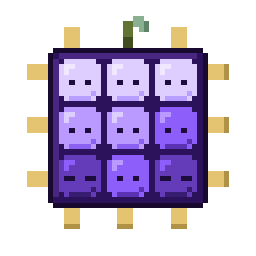
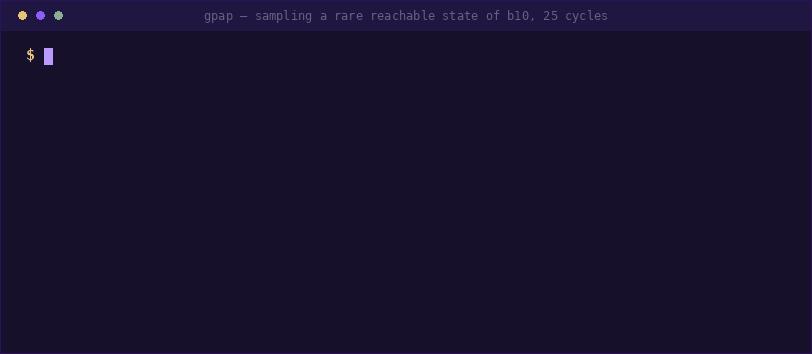
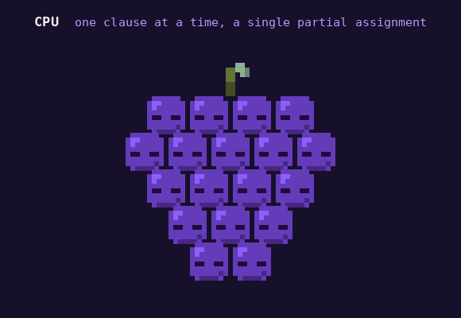

<div align="center">

<picture>
  <source media="(prefers-color-scheme: dark)"  srcset="docs/assets/animation/gpap_idle_wake_dark.gif">
  <source media="(prefers-color-scheme: light)" srcset="docs/assets/animation/gpap_idle_wake_light.gif">
  
</picture>

# GPAP

**GPU-Parallel (partial) Assignment Propagation**

Boolean constraint propagation across **hundreds of thousands of independent partial assignments in
one kernel launch** — and the CircuitSAT solution sampler built on it, where **every emitted sample
is a real solution**. No gradient, no rounding, no repair pass.

[](https://github.com/yogevshalmon/gpap/actions/workflows/ci.yml)
[](LICENSE)
[](pyproject.toml)
[](cpp/)
[](#install)

[**Docs**](docs/) · [**Engine internals**](docs/ENGINE.md) · [**Python API**](docs/PYTHON_API.md) ·
[**C++ API**](cpp/README.md) · [**Benchmarking**](docs/BENCHMARKING.md) · [**Artifact**](ARTIFACT.md)



<sub>Pinning <code>b10</code> to a rare reachable state, 25 cycles deep, and writing 50,000 input
stimuli that reach it.</sub>

</div>

---

## What it is

Two things that share one engine, and one compiled library — [`libgpap`](cpp/) — behind both:

- **The engine** ([`gpap.engine`](gpap/engine/), [`cpp/`](cpp/)) propagates K independent
  assumption sets to fixpoint in parallel, with **no clause scanning at all**
  ([below](#the-core-idea-propagate-everything-at-once)). A second, fused kernel runs a whole
  randomized decide-and-propagate trajectory per row in one launch.
- **The sampler** ([`gpap.sampling`](gpap/sampling/)) is GPU-parallel CMSGen: K randomized BCP
  completions per chunk. It samples the primary-input support of unrolled sequential and
  combinational circuits — the setting of the recent GPU-sampling papers (DEMOTIC, Recurrent
  CircuitSAT) — as well as plain projected CNF.

|  |  |
|---|---|
| **Every sample is a solution** | A row is a randomized propagation to a total assignment, so validity is structural rather than checked afterwards. Turn on `--verify-sound` to re-check every emitted row on the GPU anyway, and `--sim-check` to replay each one through the *original circuit*, independently of the encoder. |
| **No clause scanning** | Negated occurrence lists, one packed 32-bit word per long clause, and the sum trick — the whole per-literal update is a single `atomic_add` whose return value *is* the unit/conflict detection. |
| **It sizes itself** | No batch size appears in any example below. The batch is an analytic bound over the card's free VRAM; the kernel choice, the trail bound and the packed layout are all derived from the formula. |
| **One library, two faces** | Python (ctypes) and C++ (`#include <gpap/gpap.hpp>`) are both thin marshalling layers over the same core. At one seed, one config and one batch they draw *identical* models — and a test asserts it. |
| **Runs on a driver alone** | Kernels are Triton, compiled ahead of time into the library. At run time `libgpap.so` links `libcuda.so.1` and nothing else: no CUDA toolkit, no nvcc, no Triton, not even torch for the C++ face. |
| **Measured honestly** | Setup is inside the end-to-end rate, rivals are timed the way they time themselves, and nothing is quietly dropped from a mean. [`docs/BENCHMARKING.md`](docs/BENCHMARKING.md) |

## How fast

Measured on the published benchmark sets of the GPU samplers — ISCAS-85, ISCAS-89 and ITC'99
circuits, unrolled and pinned:

| GPAP's sampling rate | |
|---|---|
| vs **CMSGen** — the CPU sampler GPAP parallelizes, on the identical CNF | **~100× – 1,200×** |
| vs **DEMOTIC** and **Recurrent-CircuitSAT** — GPU gradient samplers, on their own instances | **2× – 170×** |

> [!NOTE]
> Geometric means per benchmark set, on an NVIDIA L4. The spread is real, not a rounding choice:
> the ratio depends on the instance and on how rare the pinned target is. Charging setup to both
> sides brings the CMSGen figures down by roughly 2–4×. Every instance, every excluded cell and
> every case where a tool emitted nothing is listed in
> [`docs/paper/RESULTS.md`](docs/paper/RESULTS.md).

## Install

```bash
pip install -e ".[build]"    # python side + triton (triton ships with torch on Linux/Colab)
scripts/build_core.sh        # the engine core, libgpap.so (cmake + a C++17 compiler; no CUDA toolkit)
pip install -e ".[dev]"      # + pytest, ruff, python-sat
gpap info                    # device, kernels, encoder, power-limit warning
```

`scripts/build_core.sh` compiles the Triton kernels ahead of time and builds the library; it needs
cmake, a C++17 compiler, the NVIDIA driver and, at build time only, triton. The cubins target one
GPU architecture, so rebuild on a different card generation — the loader says so by name.

> [!IMPORTANT]
> A CUDA GPU is required. There is no CPU path, and this is a design decision rather than a gap:
> the whole point is the batch.

## Quickstart — Python

```python
import gpap

# A DIMACS CNF (support read from `c ind` header lines if present)
samples, info = gpap.sample("formula.cnf", n=50_000, seed=5)
samples.shape                 # (50000, S) uint8, one column per support variable
info["cols"]                  # the DIMACS variable each column stands for
print(info["samples_per_s"], info["success_rate"], info["sound_check"])

# A sequential circuit: unroll T cycles, pin outputs to a reachable pattern, sample the inputs
samples, info = gpap.sample_circuit("b10.bench", cycles=25, n=50_000)
info["wire_map"]              # column -> "input@cycle"

# In-memory clauses
samples, info = gpap.sample_clauses(3, [[1, 2], [-1, 3], [-2, -3]], n=1_000, support=[0, 1, 2])

# The engine as a primitive: batched assumption checking
from gpap.engine import AssumptionChecker
r = AssumptionChecker("formula.cnf").check_assumptions([[1, -2, 3], [-1, 2, -3]])
print(r["conflict"])          # (n,) bool
```

Nothing above names a batch size: every entry point sizes itself to the GPU and the formula.
`samples` is a `(rows, S)` uint8 matrix of support projections, projected on the GPU and collected
off the timing path; a run cut short by its time limit returns what it produced. `info` carries
throughput (`samples_per_s` steady state, `sps_e2e_total` including setup), `success_rate`,
per-phase timings, mining stats and the soundness verdict.
[`docs/PYTHON_API.md`](docs/PYTHON_API.md) maps the API tiers.

## Quickstart — CLI

```bash
gpap sample formula.cnf -n 50000 --out samples.out --stats run.json
gpap sample b10.bench --cycles 25 -n 50000 --out stim.out   # unroll, sample, write input stimuli
gpap sample design.aig --cycles 25 -n 50000                 # AIGER input (.aig/.aag)
gpap sample b10.bench --cycles 25 --encoder abc             # smaller CNF via berkeley-abc
gpap mine formula.cnf --width 1 2 --pool all --seconds 10 --out stronger.cnf
gpap circuit2cnf benches/ cnf_out/ --cycles 25 --pin-outputs 1
gpap bench 'benches/*.bench' --encoders tseitin abc:fast --cycles 25 --target rare --resume
```

<details>
<summary><b>Circuit inputs, targets and the rejection baseline</b></summary>

<br>

`.bench` (ISCAS-85/89, ITC'99) and AIGER `.aig`/`.aag` are parsed natively. Sequential circuits are
unrolled `--cycles` times from the reset state, the last-cycle outputs are pinned to a simulated
reachable pattern, and the primary inputs across cycles become the sampling support (`wire@cycle`
columns).

`--target rare` pins the rarest output pattern seen in a large simulation batch instead of a random
one, which is biased toward easy patterns. `--sim-baseline` measures the CNF-free rival — random
inputs plus bit-parallel simulation — and reports its acceptance rate beside GPAP's; `--sim-check`
simulates every emitted sample through the original circuit as an encoder-independent soundness
check.

</details>

<details>
<summary><b>The ABC encoder</b></summary>

<br>

`--encoder abc` unrolls and logic-optimizes the circuit with
[berkeley-abc](https://github.com/berkeley-abc/abc) and Tseitins the resulting AIG. The projected
solution space is identical to the native encoder's (asserted by `tests/test_abc_encoder.py`); only
internal variables change, and the clause count drops by 2–8× on the benches here.
`scripts/build_abc.sh` builds a pinned upstream commit into `.gpap/bin`; `--abc-opt full|fast|auto`
picks the effort. The default stays `tseitin` so results never change with ABC's presence.

</details>

<details>
<summary><b>Writing solutions, and comparing against CMSGen</b></summary>

<br>

`--out FILE` writes support projections, one bit per support variable
(`--out-format bits|npy|dimacs`), collected by the timed run itself; `--stats FILE` writes the run's
info JSON. `--max-samples` (default 100k) is a ceiling.

Build CMSGen with `scripts/build_cmsgen.sh` (pinned upstream plus `scripts/cmsgen_gpap_eval.patch`,
which adds `--nowrite` and `--statsevery`). GPAP's timed run emits nothing, so `gpap bench` times
CMSGen the same way and reports its emission cost apart —
[`docs/BENCHMARKING.md`](docs/BENCHMARKING.md).

The full experimental sweep, the rival harnesses and the figures live in
[`docs/EVAL_RUNBOOK.md`](docs/EVAL_RUNBOOK.md):

```bash
eval/rivals/rivals_setup.sh     # abc + patched cmsgen + DEMOTIC / Recurrent-CircuitSAT / HTS
eval/run_full_eval.sh campaign  # the paper run; resumable
```

</details>

## Quickstart — C++

The same library: a C ABI (`gpap/gpap.h`) plus a header-only C++ layer (`gpap/gpap.hpp`).

```cpp
#include <gpap/gpap.hpp>

gpap::Sampler sampler("formula.cnf");
gpap::Solutions sols = sampler.sample(100000);     // 100k satisfying assignments
bool v = sols(i, j);                               // of variable sols.variables()[j]

gpap::Engine engine(formula);                      // or own the loop yourself
engine.reset(65536);
engine.trajectory(order, n_support, /*B=*/8, seed);
int models = engine.select_complete(engine.pair_mask());
```

```cmake
find_package(gpap REQUIRED)
target_link_libraries(my_solver PRIVATE gpap::gpap)
```

Examples for both faces in [`cpp/examples/`](cpp/examples/) and [`examples/`](examples/); details in
[`cpp/README.md`](cpp/README.md).

## The core idea: propagate everything at once

<div align="center">

<picture>
  <source media="(prefers-color-scheme: dark)"  srcset="docs/assets/animation/gpap_propagate_dark.gif">
  <source media="(prefers-color-scheme: light)" srcset="docs/assets/animation/gpap_propagate_light.gif">
  
</picture>

</div>

A CPU sampler propagates **one partial assignment at a time**. GPAP runs the same implication wave
across **every row of the batch in one kernel launch** — and that is the whole speedup. It is not a
cleverer search: it is the same randomized decide-and-propagate loop CMSGen runs, only with
propagation throughput raised to **billions of implications per second**. (The one algorithmic
difference is at a conflict, where CMSGen backtracks and GPAP simply drops the row.)

That is affordable only because a clause is never scanned:

1. **Negated occurrence lists** (CSR): `occ[l]` is the set of clauses where `~l` appears, so setting
   `l` TRUE falsifies `~l` in exactly those clauses — and in no others. Binary clauses live only
   here, as implication edges with zero per-row state; unit clauses live in a bitmap.
2. **One packed word per clause of length ≥ 3**, batched over every row: the low bits count the
   non-falsified literals (`0` = conflict, `1` = unit), the high bits hold the sum of their indices.
3. **The sum trick**: at count 1, the surviving literal's index *is* the sum. No scan, no gather.
   The whole clause update is one `atomic_add` whose return value gives race-free unit and conflict
   detection.

Literal indexing is `+v → 2(v-1)`, `-v → 2(v-1)+1`, negation `l ^ 1`; the assignment is a bitmap in
which `l` and `~l` share a word, so a single `atomic_or` answers both "already set?" and
"contradiction?". Because BCP fixpoints are confluent, the kernels are A/B'd against a pure-Python
reference and every emitted model is externally verifiable.
[`cpp/kernels/bcp.py`](cpp/kernels/bcp.py) · [`docs/ENGINE.md`](docs/ENGINE.md)

## Uniformity

A uniformity number is a claim about a distribution, so `gpap sample` does not make one. The tools
that do live in [`eval/uniformity/`](eval/uniformity/): an exact-oracle fuzzer over enumerable
instances, and a [Barbarik](https://github.com/meelgroup/barbarik) harness with GPAP hooked
in-process and SPUR as the reference. Run it with both controls — an exactly uniform sampler under
test must Accept, and the `soft` config must Reject. The guarantee is asymmetric: Reject is
unconditional, Accept is "not caught".
[`docs/findings/UNIFORMITY_FINDINGS.md`](docs/findings/UNIFORMITY_FINDINGS.md)

## Layout

```
cpp/              # the engine core: libgpap, C ABI + C++ wrapper, shared by both faces
gpap/
  engine/         # the Python face of the core (ctypes)
  sampling/       # the sampler, the e2e pipeline, preprocessing, output
  circuits/       # .bench / AIGER parse, unroll, Tseitin, pin -> projected-sampling CNF
  mining.py       # entailed-clause mining over the core's probe primitive
  cli.py          # `gpap` subcommands
eval/             # the experiment layer: campaign driver, rival harnesses, uniformity, paper tables
scripts/          # build libgpap, optional third-party tools, fetch benchmarks
docs/             # start at docs/README.md; docs/findings/ is the evidence behind every rule
tests/            # pytest (CPU smoke + `gpu`/`slow` markers); circuit CNFs generated on demand
benchmarks/       # small committed .bench sources (CNFs are generated, never committed)
.gpap/            # built/fetched tools and benchmark sets, gitignored
```

**Code carries the rule; `docs/` carries the evidence.** A comment says what the code does and why
it is correct; the measurement that settled it — date, GPU, per-instance table — lives in
[`docs/findings/`](docs/findings/), never in a source file.

## Tests

```bash
pytest -m "not gpu and not slow"   # portable smoke suite, no GPU needed
pytest                             # full suite (GPU tests skip off-CUDA; `slow` = deep unrolls)
```

## Citation and license

[`CITATION.cff`](CITATION.cff). MIT — see [`LICENSE`](LICENSE).

<div align="center">
<br>
<picture>
  <source media="(prefers-color-scheme: dark)"  srcset="docs/assets/animation/gpap_story_dark.gif">
  <source media="(prefers-color-scheme: light)" srcset="docs/assets/animation/gpap_story_light.gif">
  
</picture>
</div>
