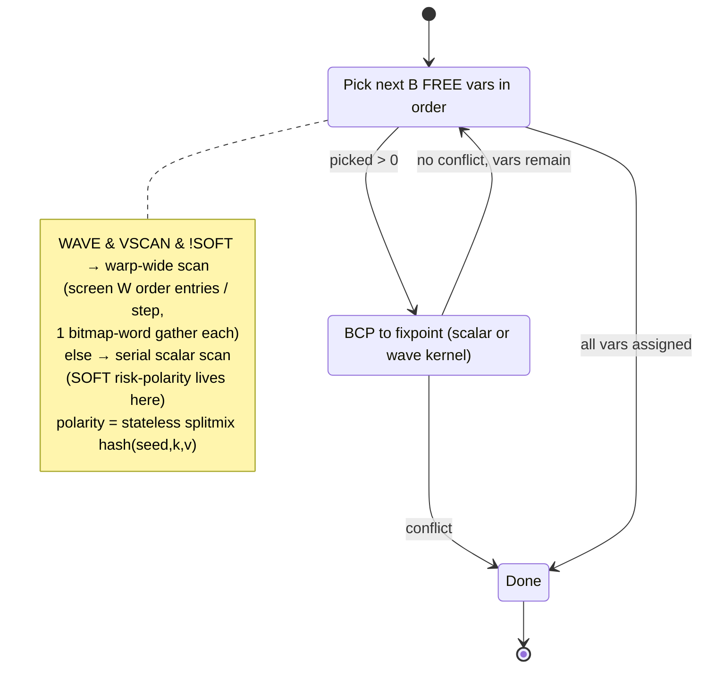
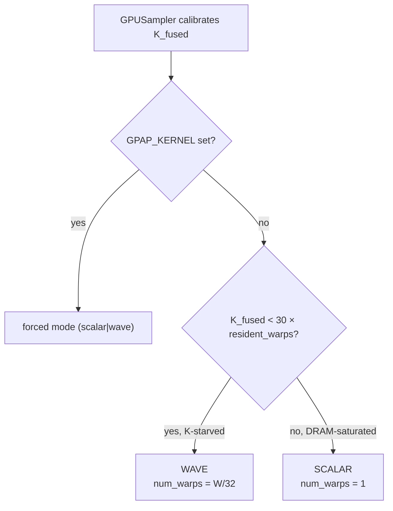

# GPAP BCP Engine — Architecture & Kernel Overview

The engine is a **K-parallel packed BCP primitive**: it runs Boolean Constraint Propagation over
`K` *independent* assumption sets at once, entirely on the GPU, with **no clause scanning ever**.
This document is the map of [`cpp/kernels/bcp.py`](../cpp/kernels/bcp.py) (the two Triton kernels) and
[`bcp_engine.py`](../gpap/engine/bcp_engine.py) (state + launch plumbing), reflecting the
2026-07 kernel work (SUM word, WAVE propagate, warp-wide decision scan, assignment bitmap).

---

## 1. The unifying idea: two self-detecting words

Every BCP step in a CDCL-style engine has to answer, per touched clause: *did this clause just
become empty (conflict) or unit (a forced literal)?* — and per forced literal: *is it already
assigned / is its negation assigned (contradiction)?*

GPAP encodes **both** questions so that the answer falls out of a **single word update whose old
value is the entire detection logic**. This is what makes the whole thing warp-parallelizable:
in the WAVE kernel each update is one `atomic`, and the atomic's *return value* resolves the race.

| State | One word holds | Update is | Old value tells you |
|-------|----------------|-----------|---------------------|
| **Clause** `(K,M)` int32 | `sat_count` \| `Σ surviving lit-indices (mod 2^F)` | `atomic_add(−(1+(¬l≪SHIFT)))` | `cnt==1`→emptied (conflict); `cnt==2`→now unit, forced lit `= (old_sum−¬l) & MASK` |
| **Assignment** `(K,⌈2N/32⌉)` int32 bitmap | bit `l` = literal `l` is TRUE | `atomic_or(1≪(l&31))` | old bit `l`→duplicate; old bit `l^1`→contradiction |

Because `l` and `l^1` (a variable's two polarities, `2v` and `2v+1`) always land in the **same
32-bit word**, one load/one atomic on the assignment answers free / duplicate / contradiction
together.

### Bit layout of the packed clause word

```
 SHIFT = 16   (16|16 split, used when 2N ≤ 65535)
   bit:  31                    16 15                     0
        +------------------------+------------------------+
        |  Σ surviving lits  %2^16 |      sat_count         |
        +------------------------+------------------------+
                (high field)              (low field)

 SHIFT = 8    (8|24 "wide" split, 2N ≤ 0xFFFFFF and max clause len ≤ 255)
   bit:  31                                 8 7           0
        +------------------------------------+-------------+
        |     Σ surviving lits  % 2^24        |  sat_count  |
        +------------------------------------+-------------+
```

Why a **sum** (not a plain counter + separate literal list): every literal removal subtracts that
literal's index from the high field, exactly mod `2^F`. When `sat_count` reaches 1 there is exactly
one surviving literal, so the high field **is** that literal's index — no list, no scan. The update
is a single subtraction, `st -= 1 + (¬l << SHIFT)`:

- the `−1` only touches `sat_count`; `sat_count ≥ 1` always holds when we decrement (a row that hit
  0 conflicts and stops), so it **never borrows** into the sum field;
- the `−(¬l << SHIFT)` only touches the sum field, wrapping harmlessly off bit 31.

Formulas outside both envelopes are **rejected** at construction — there is no unpacked fallback.

---

## 2. Lifecycle & dataflow

```mermaid
flowchart TD
    F[CnfFormula<br/>clauses, 2N literal-index scheme] --> OCC[occ CSR int32<br/>occ&#91;l&#93; = clauses where ~l appears]
    F --> INIT["packed_init (M,) int32<br/>sat_count | (Σ lit &lt;&lt; SHIFT)"]
    OCC --> ENG[BCPEngine.__init__]
    INIT --> ENG
    ENG --> FLUSH["_build_flush_cache()<br/>reset(1) + assert unit clauses + BCP<br/>ONE fixpoint launch at K=1"]
    FLUSH --> CACHE["cached flush state<br/>packed_flushed / abits_flushed / flush_conflict"]

    CACHE -->|"reset(K): broadcast-copy, no per-chunk flush"| STATE["live row state (K rows)<br/>_packed (K,M) · _abits (K,⌈2N/32⌉)<br/>_active · _conflict"]

    STATE --> EP1
    STATE --> EP2
    subgraph EP["Two entry points"]
      EP1["apply_and_propagate(dec)<br/>= _bcp_fixpoint_kernel<br/>batched assumption checking"]
      EP2["run_trajectory(order,B,seed,soft)<br/>= _bcp_trajectory_kernel<br/>whole sampling loop, fused"]
    end
    EP1 --> READ
    EP2 --> READ
    READ["readout:<br/>select_complete · check_sound · var_bits (on device)<br/>conflict · active · assignment (copies)"]
```



The flush cache is the key construction-time optimization: the state *after* asserting the formula's
own unit clauses is identical for every row of every chunk, so it is computed **once** and
`reset(K)` just broadcast-restores it (one big copy, no per-chunk unit flush).

---

## 3. The propagate primitive — scalar vs WAVE

Both kernels share the same trail-driven BCP core; only *how many literals are drained per step*
differs. One Triton **program owns one row `k`** exclusively (its `_packed[k]` / `_abits[k]` are
program-private) so there are **no cross-program races** — the only races are *within* a WAVE
program's lanes, and those are exactly what the atomics resolve.

```mermaid
flowchart LR
    subgraph SCALAR["_propagate  (scalar, 1 useful lane)"]
      direction TB
      S1[pop 1 literal off trail] --> S2["walk occ&#91;l&#93; serially"]
      S2 --> S3["st = load − 1 − (¬l≪SHIFT); store"]
      S3 --> S4{sat?}
      S4 -->|0| SC[conflict]
      S4 -->|1| S5["forced = st≫SHIFT<br/>1 bitmap load: dup? contra?<br/>else set bit + push trail"]
      S4 -->|">1"| S2
      S5 --> S2
    end
    subgraph WAVE["_wave_propagate  (W lanes, atomics)"]
      direction TB
      W1["pop ≤W literals<br/>flatten their occ segments<br/>(cumsum + one-hot schedule)"] --> W2["W clause updates / step:<br/>atomic_add(−(1+(¬l≪SHIFT)))"]
      W2 --> W3{"old sat_count<br/>(per lane)"}
      W3 -->|==1| WC[conflict this lane]
      W3 -->|==2| W4["forced = (old_sum−¬l) AND MASK<br/>atomic_or bit → old word = dup/contra<br/>cumsum-compact survivors to trail"]
      W3 -->|">2"| W2
      W4 --> W2
    end
```



- **Scalar** is warp-uniform (1 useful lane of 32) and needs **no atomics** — the row is private and
  drained one literal at a time. It wins when `K` is large (thousands of rows already saturate the
  scattered-DRAM ceiling; extra lanes buy nothing).
- **WAVE** issues up to `W` scattered clause requests in flight per row (Little's law: fills the
  memory pipeline when `K` is small and rows are MLP-starved). The old `W×W` in-warp dedup for the
  unit pushes is **gone** — the assignment `atomic_or`'s return value dedups and detects
  contradictions directly, even when two lanes force `l` and `¬l` in the same step (they serialize in
  the L2 atomic unit; exactly one sees the other's bit).

**Confluence guarantee:** the two variants visit clauses in different *orders*, but BCP fixpoints are
confluent — every non-conflicted row reaches the **bit-identical** fixpoint. This is the invariant
the no-change gate checks, and why mode is a pure launch-flag choice.

---

## 4. The trajectory kernel — the whole sampling loop, fused

`_bcp_trajectory_kernel` runs an entire randomized decide-and-propagate trajectory per row in one
launch (no host round-trips). `order` is the decision priority (support vars first, then completion
vars); a decision group never straddles the support/completion boundary.



A row that reaches `ptr == P` with no conflict is **fully assigned = a guaranteed model**. The
sampler reads those out (`active & ~any_free`).

Two optional polarity/scan behaviours, both compile-time `constexpr` so they specialize to their own
binaries:

- **`VSCAN` (warp-wide decision scan)** — screens `W` `order` entries per step with one bitmap-word
  gather instead of walking them one-by-one. **WAVE-only**: once the assignment became a bitmap the
  serial scan is L1-cheap, so the warp-wide screen only pays off in WAVE's low-K regime (`GPAP_VSCAN=0`
  disables).
- **`SOFT` (conflict-avoidance polarity)** — picks the lower-"risk" polarity by summing `sat_count`
  weights over the literal's occ list, ε-greedy for diversity. Lives in the scalar pick loop only.

---

## 5. Mode & width dispatch



- **Auto-dispatch** trades one number: below ~30× the GPU's resident-warp count the rows can't fill
  the memory pipeline on their own, so WAVE's extra in-flight requests win; above it, scalar's
  zero-atomic path is already at the ceiling. The threshold is device-derived (`resident =
  SM_count × max_threads_per_SM / 32`) so it transfers across GPUs.
- **Lane width `W`** (`GPAP_WAVE_W`, default 32): `W>32` spreads the wave tensors over `W/32` **real**
  warps (`num_warps`), but the cross-warp reduction sync per step dominated — measured worse — so
  W=32 / one warp is the default.

---

## 6. What changed, and why (2026-07 kernel work)

| Change | Before | After | Payoff |
|--------|--------|-------|--------|
| **Packed high field** | XOR of surviving lits | **modular SUM** | update = one `atomic_add`; return value gives conflict + unit + forced lit → WAVE became exact |
| **WAVE propagate** | scalar only (1 lane/warp) | `≤W` lits/step, occ flattened | fills MLP on K-starved big-M rows |
| **Assignment** | `(K,2N)` int8 (byte/lit) | **`(K,⌈2N/32⌉)` bitmap** | one `atomic_or` = dedup+contradiction (W×W dedup deleted); 8× smaller → L1/L2-resident |
| **Decision scan** | serial, one entry/step | warp-wide screen (`VSCAN`, WAVE-only) | +12–19% at wave K |
| **K calibration** | PyTorch-era floor | `K = min(analytic, cap)` | ~3× more rows resident |
| **Dispatch threshold** | 6× resident | **30× resident** | bitmap removed WAVE's large-K tax; wave wins further out |

**Readout note:** the bitmap must never be unpacked with strided slice-writes (16× sector-RMW
amplification). Hot paths use `select_complete` (one bitwise pass over the words inside the core — only the
count crosses the bus, no `(K,N)` mask) and `var_bits` (direct bit gather for just the needed
columns); `assignment` / `assignment_rows` materialize the historical int8 layout only when a
caller genuinely needs it.

---

## 7. Correctness & the contract

- **Two entry points only** (`apply_and_propagate`, `run_trajectory`) plus accessors — app code never
  touches `_packed` / `_abits`.
- **conflict / active flags are exact** (confluence). Non-conflicted rows carry the exact BCP
  fixpoint; conflicted rows' partial state is intentionally unspecified (the sampler reads only
  `active & fully-assigned` rows).
- **Validated** against a pure-Python reference BCP ([`tests/reference_bcp.py`](../tests/reference_bcp.py))
  and by external model verification; a bit-identical model-set gate re-runs on every kernel change,
  in scalar, wave, and `VSCAN=0` modes.
