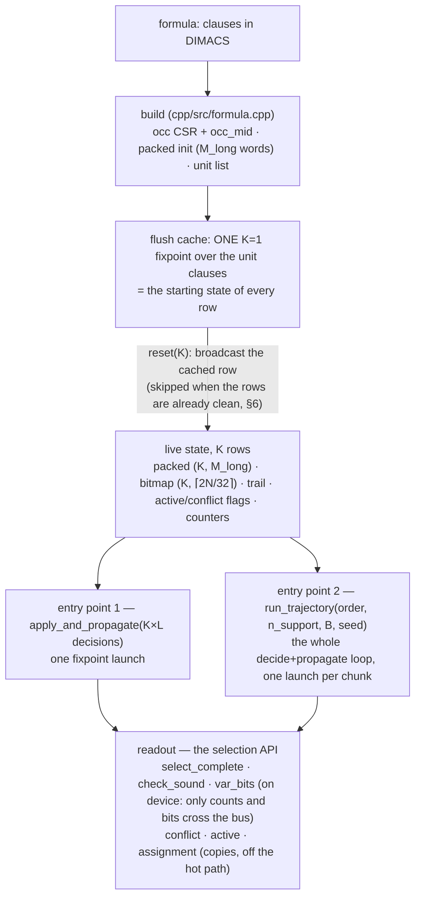
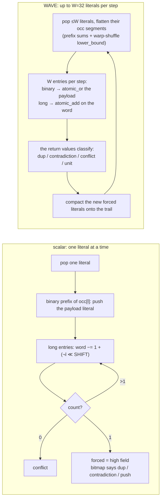
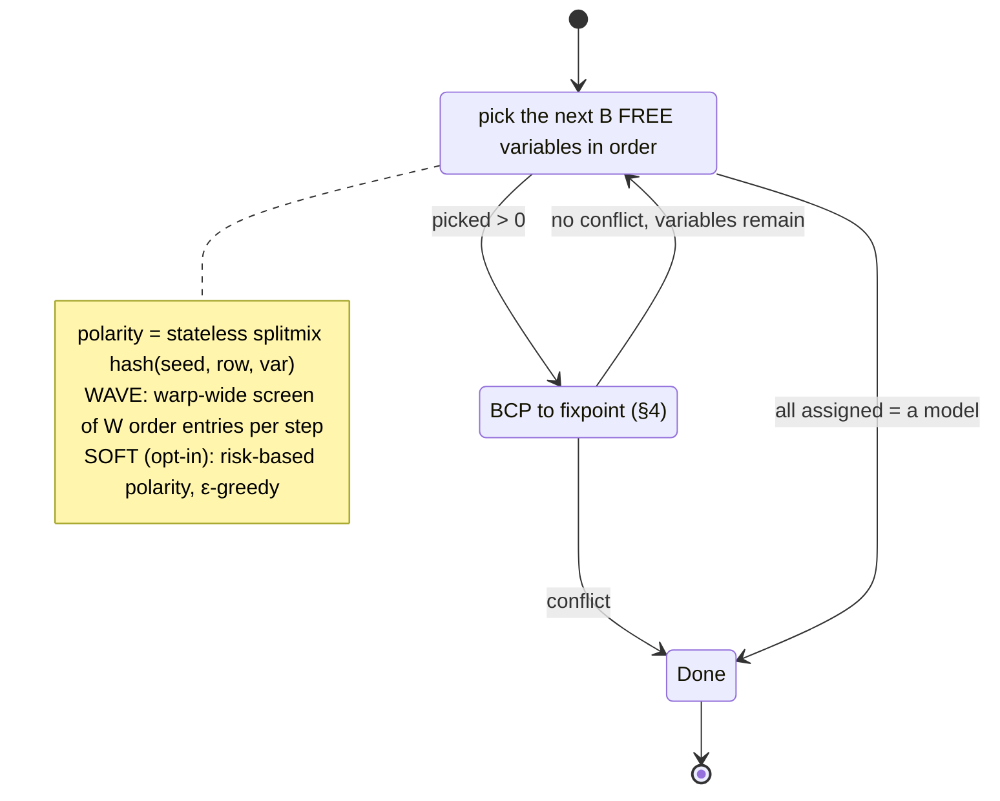

# The GPAP engine — how it works

GPAP's engine runs **Boolean Constraint Propagation (BCP) over K independent assumption sets at
once**, entirely on the GPU. K ranges from a few thousand rows on the largest formulas to 262,144;
each row is its own partial assignment of the same formula, propagated to its own fixpoint, and
no clause is ever scanned. Everything else in the repository — the solution sampler,
entailed-clause mining, batched assumption checking — is a consumer of this one primitive.

The engine is one C++ library, `libgpap` ([`cpp/`](../cpp/)), with a C ABI and two faces: Python
through ctypes and C++ through `<gpap/gpap.hpp>`. The GPU kernels are written in Triton
([`cpp/kernels/bcp.py`](../cpp/kernels/bcp.py)) and compiled ahead of time into the library, so
running it needs only the NVIDIA driver (`libcuda`) — no CUDA toolkit, no Python.

This page is for someone who wants to build on the engine or judge its claims. Using it needs
none of this: see [PYTHON_API.md](PYTHON_API.md) and [`cpp/README.md`](../cpp/README.md).

## 1. The formula on the GPU

**Literals are indices.** DIMACS `+v` becomes `2(v−1)` and `−v` becomes `2(v−1)+1`, so negation
is `l ^ 1` and a variable's two polarities are always neighbours. `N` variables give `2N` literal
indices.

**Negated occurrence lists.** For every literal `l`, `occ[l]` lists the clauses in which `~l`
appears — exactly the clauses that lose a literal when `l` becomes TRUE. Setting `l` walks
`occ[l]` and nothing else; that is the whole reason nothing is ever scanned. The lists are one
CSR array shared read-only by every row.

**Clauses are segregated by length**, because they need very different amounts of state:

| clause length | where it lives | per-row state | propagating it costs |
|---|---|---|---|
| 1 (unit) | asserted once, at construction, into the *flush cache* (§3) | none | nothing — it is a fact in every row's starting state |
| 2 (binary) | an **implication edge** in `occ`: the entry for `(~l \| b)` in `occ[l]` carries `b` itself | none | one bitmap `atomic_or` (§2) |
| ≥ 3 (long) | a clause index in `occ`, plus one packed **counter word** per row | 4 bytes | one `atomic_add` on that word (§2) |

On circuit CNFs 59–82% of clauses are binary and only 10–23% are long, so per-row state is
`4·M_long` bytes rather than `4·M`. Within each `occ[l]` segment the binary entries come first
(`occ_mid[l]` marks the split), so the cheap path is a tight prefix loop.

## 2. Two words that detect their own events

Every BCP step must answer, per touched clause, *did this clause just become empty (conflict) or
unit (a forced literal)?* — and per forced literal, *is it already assigned, or is its negation
(a contradiction)?* GPAP encodes both so that **the old value of a single word update is the
whole answer**. That is what makes the warp-parallel kernel possible: each update is one atomic,
and the atomic's return value resolves any race between lanes.

| state | one word holds | the update | what the old value says |
|---|---|---|---|
| **long clause** — `(K, M_long)` int32 | `sat_count` in the low `SHIFT` bits; the **sum of the surviving literal indices** mod 2^(32−SHIFT) above | `atomic_add(−(1 + (¬l ≪ SHIFT)))` | old count 1 → this update emptied the clause (conflict); old count 2 → it is now unit, and the forced literal is `(old_sum − ¬l) & MASK` |
| **assignment** — `(K, ⌈2N/32⌉)` int32 bitmap | bit `l` = literal `l` is TRUE | `atomic_or(1 ≪ (l & 31))` | old bit `l` → duplicate, skip; old bit `l^1` → contradiction |

**Why a sum.** When `sat_count` reaches 1 exactly one literal survives, so the sum of surviving
indices *is* that literal — no list to keep, nothing to scan. Every removal subtracts one index,
exact modulo 2^F, and the two fields never interfere: `sat_count ≥ 1` whenever a decrement happens
(a row that reaches 0 has conflicted and stops), so the `−1` never borrows into the sum, and the
sum wraps harmlessly off the top of the word.

```
 SHIFT = 16   (16|16 split: 2N ≤ 65,535, clause length ≤ 65,535)
   bit:  31                     16 15                      0
        +-------------------------+-------------------------+
        |  Σ surviving lits % 2^16 |        sat_count        |
        +-------------------------+-------------------------+

 SHIFT = 8    (8|24 "wide" split: 2N ≤ 16,777,215, clause length ≤ 255)
   bit:  31                                  8 7            0
        +--------------------------------------+--------------+
        |      Σ surviving lits % 2^24          |  sat_count   |
        +--------------------------------------+--------------+
```

The split is chosen per formula — 16|16 when it fits, else 8|24. A formula outside both envelopes
is **rejected at construction**; there is no slower fallback path.

**Why a bitmap.** `l` and `l^1` share a 32-bit word, so one load (or one atomic) answers
free / duplicate / contradiction together, and the assignment is 8× smaller than a byte per
literal — small enough to stay cache-resident for most formulas.

## 3. Lifecycle



Construction runs the unit clauses to fixpoint **once**, at K=1. Every row of every chunk starts
from that same state, so `reset(K)` is a broadcast copy of one cached row — never a per-chunk
propagation.

**Entry point 1 — batched assumption checking.** Each row receives its own set of assumed
literals and is propagated to fixpoint in one launch. `check_sets` wraps it for any number of
sets (the chunk loop is `cpp/src/check.cpp`, shared by both faces), and the *probe*
(`cpp/src/probe.cpp`) feeds it every k-subset of a literal pool under a work budget — the
primitive behind failed-literal detection and entailed-clause mining.

**Entry point 2 — fused trajectory sampling.** Each row runs a whole randomized
decide-and-propagate trajectory: take the next `B` free variables in a caller-supplied order,
give each a hash-derived polarity, propagate, repeat until the row is fully assigned (a model) or
conflicts. No host round-trips inside the loop (§5).

**Readout never moves row state.** The selection API computes "which rows are complete, and
sound" on the device and hands back a count; `var_bits` then gathers only the columns asked for.
[`cpp/SELECTION_API.md`](../cpp/SELECTION_API.md) explains it with a worked example. The
tensor-shaped accessors (`assignment`, `conflict`, `active`) are copies for tests and
off-hot-path consumers.

## 4. Propagation: the scalar and WAVE kernels

Both kernels drain a per-row **trail** of literals to propagate. One Triton program owns one row,
so rows never race with each other; the only races are between lanes inside a WAVE program, and
those are exactly what the atomics of §2 resolve.



- **Scalar** walks one literal's occurrences serially and needs no atomics. It keeps one memory
  request in flight per row, which is enough when the formula is tiny — the walks are short and
  there are many rows.
- **WAVE** issues up to `W` scattered requests per row per step, which fills the memory pipeline
  when rows are few or occurrence lists are long. Two lanes forcing `l` and `¬l` in the same step
  serialize on the bitmap word; exactly one of them sees the other's bit.

**Which one runs is decided by the clause count** (`gpap_dispatch_wave` in
`cpp/src/calibrate.cpp`, resolved inside every `reset`, so every consumer gets it): WAVE when
`M ≥ 2048`, or when the batch is no larger than the card's resident warps (too few rows for scalar
to fill it); scalar otherwise. The rule keys off `M`, not the batch — a batch-based rule was a
proxy for `M` that broke when batch sizing changed. `GPAP_KERNEL=scalar|wave` forces a kernel; it
can only change speed, never results.

**Confluence.** A BCP fixpoint is unique, so the two kernels — which visit clauses in different
orders — reach bit-identical states on every row that does not conflict. A row that conflicts
stops at the first emptied clause, and *which* clause that is depends on order; its partial state
(and its implication counter) is therefore unspecified, while its `conflict` flag is exact.

## 5. The trajectory kernel

`_bcp_trajectory_kernel` fuses the sampler's loop. `order` is the decision priority — the
independent support first, completion variables after — and a decision group never straddles
that boundary: phase 1 reaches a fixpoint over the support before any completion variable is
decided (straddling it once collapsed an instance's success from 100% to 0%).



A row that assigns every variable without conflicting is a model by construction. The selection
API reads those rows out, and `check_sound` re-verifies every clause of every selected row on the
device — binaries and units against the bitmap, long clauses against their words — independently
of the propagate kernels' own bookkeeping.

Two compile-time variants: **VSCAN** (WAVE only) screens `W` order entries per step with one
bitmap gather instead of walking them one by one — the same picks, 12–19% faster where it
applies. **SOFT** chooses the lower-risk polarity from the clauses each literal would touch; it is
opt-in (`--allow-soft`) because it biases the distribution enough for Barbarik to reject it.

## 6. CLEAN mode: launches that leave no trace

Probing and mining run `reset → apply → read the flags` millions of times, and the reset
broadcast (`K·M_long` words per chunk) was 50–94% of their wall while a probe dirtied at most a
few percent of the words. `apply_clean` runs the same fixpoint and then, inside the same launch,
**rewrites the words it touched back to the baseline** — the trail is still in registers and the
words are still in L2. The engine then knows those rows are clean, and the next `reset` skips
the broadcast.

The restore covers every word a row could have touched (`∪ occ[l]` over its trail), which is why
it is safe on conflicted rows that stopped mid-walk: over-restoring writes baseline over baseline.
Only the clause words are restored; the bitmap keeps the fixpoint. Readouts that need the
post-apply state (`sat_rows`, `check_sound`, `recache_flush`) therefore refuse after a clean
launch — use plain `apply` for those. `GPAP_CLEAN=0` restores the exact legacy behaviour for
A/Bs. Design and proofs: [plans/RESET_RESTORE_PLAN.md](plans/RESET_RESTORE_PLAN.md) §9.

## 7. Batch size

Nobody names K. Every face sizes it from the formula and the GPU (`cpp/src/calibrate.cpp`):

```
row_bytes = 4·M_long  +  4·⌈2N/32⌉  +  4·trail_cap  +  flags and counters
K         = min( 0.80 · free VRAM / row_bytes ,  cap )          cap = 262,144
```

`trail_cap = N + 32` is a proof, not a tuning knob: every trail push is deduplicated against the
bitmap and `l`/`¬l` share a word, so a VARIABLE can enter a row's trail at most once — the bound
is exactly `N`, whatever the decision batch `B` or the assumption width. The `+32` is one
wavefront, because the vectorised append writes at `tail + prefix_sum` with no bound test, so a
wavefront is the granularity a broken invariant would overshoot by. There is deliberately no `B`
term: one used to be here, as a floor the engine ignored while the sizing model honoured it —
charging a caller who asked for a wide decision batch for a trail that was never allocated.
The cap is likewise ONE constant on every GPU; it used to scale with total VRAM, which made
`auto` mean a different batch per machine. The model is verified
against measured VRAM (1.00–1.04×). Because `K × M_long` is roughly the memory budget however
large the formula, a chunk's wall is roughly constant, and **models per chunk = K × success** is
the throughput proxy the sampling pipeline uses when it decides whether mined clauses paid.

The cap is a saturation limit, not a safety one: on the cards measured, 4× the batch bought
~3%. Overrides exist for measurement (`k_cap`, `pin_batch`) — pin them for any A/B.

## 8. Knobs

| | effect | default |
|---|---|---|
| `GPAP_KERNEL=scalar\|wave` | force the propagate kernel | auto (§4) |
| `GPAP_CLEAN=0` | disable CLEAN mode and the reset skip (exact legacy behaviour) | on |
| `vscan = -1` in `gpap_engine_options` | disable the warp-wide decision scan | on in WAVE |
| `GPAP_LIB=/path/libgpap.so` | which library the Python face loads | `build/`, then the installed copy |
| `WAVE_W` in `cpp/tools/build_kernels.py` | lane width, a power of two, baked at build time | 32 (both ways of raising it measured out) |

## 9. What is guaranteed

- **Two entry points** — `apply_and_propagate` (with `check_sets`, the probe and `apply_clean`
  over it) and `run_trajectory` — plus readout. Application code never touches row state.
- **`conflict` and `active` are exact** on every row. A non-conflicted row holds the exact BCP
  fixpoint; a conflicted row's partial state is unspecified (§4).
- **Every emitted model is verifiable** by anyone: a full assignment satisfying every clause,
  checked on the device before it is returned and re-checkable on the host.
- **Validated** against a pure-Python reference BCP (`tests/reference_bcp.py`) and a reference
  formula builder (`tests/reference_formula.py`), in both kernels and both packed splits, plus a
  bit-identical model-count gate that re-runs on every kernel change.

## 10. Where the evidence lives

Each row is a decision the code carries; the measurement behind it is in `findings/`.

| decision | evidence |
|---|---|
| the sum-packed word — one `atomic_add` per clause update | [findings/INSIGHTS.md](findings/INSIGHTS.md), 2026-07-13 |
| the assignment bitmap — one `atomic_or` per push | INSIGHTS.md, 2026-07-14 |
| binary clauses as implication edges; only long clauses carry state | [findings/BINARY_OCC_FINDINGS.md](findings/BINARY_OCC_FINDINGS.md) |
| the WAVE propagate and its shuffle-based lane schedule | [findings/WAVE_SHUFFLE_FINDINGS.md](findings/WAVE_SHUFFLE_FINDINGS.md) |
| the `M ≥ 2048` dispatch rule; the wave/scalar ratio by formula size | [findings/KERNEL_AB_FINDINGS.md](findings/KERNEL_AB_FINDINGS.md), INSIGHTS.md 2026-08-18 |
| CLEAN mode | [plans/RESET_RESTORE_PLAN.md](plans/RESET_RESTORE_PLAN.md), [findings/MINING_FINDINGS.md](findings/MINING_FINDINGS.md) |
| the batch model, the cap, and why K is not a throughput lever | [findings/CROSS_GPU_FINDINGS.md](findings/CROSS_GPU_FINDINGS.md), INSIGHTS.md |
| the C++ core and the ahead-of-time kernel build | [findings/CPP_BACKEND_FINDINGS.md](findings/CPP_BACKEND_FINDINGS.md), [plans/CPP_CORE_PLAN.md](plans/CPP_CORE_PLAN.md) |
| what was tried and lost — XOR word, 1-byte state, W > 32, in-kernel retry, clause renumbering | INSIGHTS.md, "Engine & memory model" |
