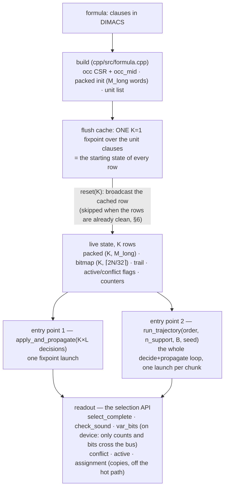

# The GPAP engine — how it works

> **Reader:** library users and contributors who want to know how the engine works — its data layout, kernels and batch sizing, and what it guarantees.

GPAP's engine runs Boolean Constraint Propagation (BCP) over K independent partial assignments
at once, entirely on the GPU. K ranges from a few thousand rows on the largest formulas to 64
rows per warp the card keeps resident; each row is its own assumption set over the same
formula, propagated to its own
fixpoint, and no clause is ever scanned. The solution sampler, entailed-clause mining and
batched assumption checking are all consumers of this one primitive.

The engine is one C++ library, `libgpap` ([`cpp/`](../cpp/)), with a C ABI and two faces: Python
through ctypes and C++ through `<gpap/gpap.hpp>`. The kernels are written in Triton
([`cpp/kernels/bcp.py`](../cpp/kernels/bcp.py)) and compiled ahead of time into the library, so
running it needs only the NVIDIA driver (`libcuda`). This page is for building on the engine or
judging its claims; using it needs none of it — see [PYTHON_API.md](PYTHON_API.md) and
[`cpp/README.md`](../cpp/README.md). The paper ([arXiv:2610.28805](https://arxiv.org/abs/2610.28805),
Section 4) presents the same design with its rationale: the jobs, the sum-packed word, the
one-bit-per-literal assignment and Wave.

## 1. The formula on the GPU

**Literals are indices.** DIMACS `+v` is `2(v−1)` and `−v` is `2(v−1)+1`, so negation is `l ^ 1`
and a variable's two polarities are neighbours. `N` variables give `2N` literal indices.

**Negated occurrence lists.** `occ[l]` lists the clauses in which `~l` appears — exactly the
clauses that lose a literal when `l` becomes true. Setting `l` walks `occ[l]` and nothing else.
The lists are one CSR array shared read-only by every row.

**Clauses are segregated by length:**

| clause length | where it lives | per-row state | propagating it costs |
|---|---|---|---|
| 1 (unit) | asserted once, at construction, into the flush cache (§3) | none | nothing |
| 2 (binary) | an implication edge in `occ`: the entry for `(~l \| b)` in `occ[l]` carries `b` itself | none | one bitmap `atomic_or` (§2) |
| ≥ 3 (long) | a clause index in `occ`, plus one packed counter word per row | 4 bytes | one `atomic_add` on that word (§2) |

On circuit CNFs 59–82% of clauses are binary and only 10–23% are long, so per-row state is
`4·M_long` bytes rather than `4·M`. Within each `occ[l]` segment the binary entries come first
(`occ_mid[l]` marks the split).

## 2. Two words that detect their own events

Every BCP step must know, per touched clause, whether it just became empty (conflict) or unit
(a forced literal), and per forced literal whether it is already assigned or contradicted. Both
are encoded so that the old value of a single word update is the whole answer — each update is
one atomic, and its return value resolves any race between lanes of the WAVE kernel.

| state | one word holds | the update | what the old value says |
|---|---|---|---|
| long clause — `(K, M_long)` int32 | `sat_count` in the low `SHIFT` bits; the sum of the surviving literal indices mod 2^(32−SHIFT) above | `atomic_add(−(1 + (¬l ≪ SHIFT)))` | old count 1: this update emptied the clause (conflict); old count 2: it is now unit, and the forced literal is `(old_sum − ¬l) & MASK` |
| assignment — `(K, ⌈2N/32⌉)` int32 bitmap | bit `l` = literal `l` is true | `atomic_or(1 ≪ (l & 31))` | old bit `l`: duplicate, skip; old bit `l^1`: contradiction |

Why a sum: when `sat_count` reaches 1 exactly one literal survives, so the sum of surviving
indices is that literal. Every removal is exact modulo 2^F, and the fields never interfere: a
decrement only happens at `sat_count ≥ 1` (a row that reaches 0 has conflicted and stops), so
the `−1` never borrows into the sum, and the sum wraps off the top of the word.

```
 SHIFT = 16   (16|16 split: 2N ≤ 65,535, clause length ≤ 65,535)
   bit:  31                     16 15                      0
        +-------------------------+-------------------------+
        |  Σ surviving lits % 2^16 |        sat_count        |
        +-------------------------+-------------------------+

 SHIFT = 8    (8|24 "wide" split: 2N ≤ 16,777,215, clause length ≤ 255)
   bit:  31                                  8 7            0
        +--------------------------------------+--------------+
        |      Σ surviving lits % 2^24          |  sat_count   |
        +--------------------------------------+--------------+
```

The split is chosen per formula — 16|16 when it fits, else 8|24. A formula outside both
envelopes is rejected at construction; there is no slower fallback. Why a bitmap: `l` and `l^1`
share a 32-bit word, so one load (or one atomic) answers free / duplicate / contradiction
together, and the assignment is 8× smaller than a byte per literal.

## 3. Lifecycle



Construction runs the unit clauses to fixpoint once, at K=1; every row of every chunk starts
from that state, so `reset(K)` is a broadcast of one cached row, never a per-chunk propagation.

**Entry point 1 — batched assumption checking.** Each row receives its own assumed literals and
is propagated to fixpoint in one launch. `check_sets` wraps it for any number of sets (the chunk
loop is `cpp/src/check.cpp`, shared by both faces), and the probe (`cpp/src/probe.cpp`) feeds it
every k-subset of a literal pool under a work budget — the primitive behind failed-literal
detection and entailed-clause mining.

**Entry point 2 — fused trajectory sampling.** Each row runs a whole randomized
decide-and-propagate trajectory: take the next `B` free variables in a caller-supplied order,
give each a hash-derived polarity, propagate, repeat until the row is fully assigned (a model) or
conflicts. No host round-trips inside the loop (§5).

**Readout never moves row state.** The selection API computes which rows are complete and sound
on the device and hands back a count; `var_bits` then gathers only the columns asked for. The
worked example is in [`cpp/README.md`](../cpp/README.md), "Getting answers out: the selection
API". The tensor-shaped accessors (`assignment`, `conflict`, `active`) are copies for tests and
off-hot-path consumers.

## 4. Propagation: the scalar and WAVE kernels

Both kernels drain a per-row trail of literals. One Triton program owns one row, so rows never
race with each other; the only races are between lanes inside a WAVE program, and the atomics
of §2 resolve exactly those.

- **Scalar** pops one literal and walks its occurrences serially: the binary prefix pushes the
  payload literal; each long entry does `word −= 1 + (¬l ≪ SHIFT)`, count 0 is a conflict and
  count 1 yields the forced literal from the high field, which the bitmap classifies as
  duplicate, contradiction or push. No atomics, one memory request in flight per row — enough
  when the formula is tiny and rows are many.
- **WAVE** pops up to `W = 32` literals, flattens their occ segments (prefix sums + a
  warp-shuffle lower_bound; no shared memory), issues `W` scattered atomics per step, classifies
  each by its return value and compacts the new forced literals onto the trail. Two lanes forcing
  `l` and `¬l` serialize on the bitmap word; exactly one sees the other's bit.

The clause count decides which one runs (`gpap_dispatch_wave` in `cpp/src/calibrate.cpp`,
resolved inside every `reset`, so every consumer gets it): WAVE when `M ≥ 2048`, or when the
batch is no larger than the card's resident warps; scalar otherwise. Do not key the rule off the
batch: a batch-based rule was a proxy for `M` that broke when batch sizing changed. The queue
of §6b is not a batch of rows and runs WAVE.
`GPAP_KERNEL=scalar|wave` forces a kernel; it can only change speed, never results.

**Confluence.** A BCP fixpoint is unique, so the two kernels — which visit clauses in different
orders — reach bit-identical states on every row that does not conflict. A conflicted row stops
at the first emptied clause, and which clause that is depends on order; its partial state and
its implication counter are unspecified, while its `conflict` flag is exact.

## 5. The trajectory kernel

`_bcp_trajectory_kernel` fuses the sampler's loop: pick the next `B` free variables in `order`
(polarity = a stateless splitmix hash of seed, row and variable), propagate to fixpoint (§4),
repeat; a row ends on conflict, or with every variable assigned — a model by construction.
`order` is the decision priority — the independent support first, completion variables after —
and a decision group never straddles that boundary: phase 1 reaches a fixpoint over the support
before any completion variable is decided (straddling it once collapsed an instance's success
from 100% to 0%).

The selection API reads the models out, and `check_sound` re-verifies every clause of every
selected row on the device — binaries and units against the bitmap, long clauses against their
words — independently of the propagate kernels' own bookkeeping.

Two compile-time variants: **VSCAN** (WAVE only) screens `W` order entries per step with one
bitmap gather instead of walking them one by one — the same picks, 12–19% faster where it
applies. **SOFT** chooses the lower-risk polarity from the clauses each literal would touch; it is
opt-in (`--allow-soft`) because it biases the distribution enough for Barbarik to reject it.

## 6. CLEAN mode: launches that leave no trace

Probing and mining run `reset → apply → read the flags` millions of times, and the reset
broadcast (`K·M_long` words per chunk) was 50–94% of their wall while a probe dirtied at most a
few percent of the words. `apply_clean` runs the same fixpoint and then, inside the same launch,
rewrites the words it touched back to the baseline — the trail is still in registers and the
words still in L2 — so the engine knows those rows are clean and the next `reset` skips the
broadcast. The restore covers every word a row could have touched (`∪ occ[l]` over its trail),
which is why it is safe on conflicted rows that stopped mid-walk: over-restoring writes baseline
over baseline. Only the clause words are restored; the bitmap keeps the fixpoint, so readouts
that need the post-apply state (`sat_rows`, `check_sound`, `recache_flush`) refuse after a clean
launch — use plain `apply` for those. `GPAP_CLEAN=0` is the exact legacy behaviour, for A/Bs.
Design, lemmas and measurements: [findings/CLEAN_MODE_FINDINGS.md](findings/CLEAN_MODE_FINDINGS.md).

## 6b. The queue: many sets on few rows

A chunked sweep gives every set a row of its own, and a launch ends with its slowest row. On a
big formula most rows sit idle while a few deep sets finish, and every chunk starts with a reset.
The queue turns this around. A launch takes a block of sets and a few rows of state. A row takes
the next set from a shared counter, propagates it with the code of §4, writes that set's conflict
flag and implied count, puts back the words it touched, and takes another. No row waits, and
nothing is reset between sets.

Two restores bring a row back: the packed words, as in CLEAN mode (§6), and the bitmap words of
the literals on the row's trail. The second is complete because the baseline is a BCP fixpoint:
no clause can force a literal that is false there, so a bit set during a set belongs to a literal
on the trail or to the negation of one, and a literal shares its word with its negation.

What runs on it: the probe sweeps (`gpap_probe_*`, so mining too) and `gpap_check_sets` when it
returns flags and counts only. A call that reads a row after its set, for assignments or sat
counts, stays in chunks: a queued row is back at the baseline by then. The answers are the
chunked sweep's, in the same order, because a set starts from the baseline whichever row runs it
and BCP is confluent.

A queued call has three steps. Between them the engine refuses, by name, every call that would
change the rows or the kernel (reset, apply, trajectory, `recache_flush`, `set_mode`, another
queued call):

- **Begin.** Every row it uses is put at the baseline. The packed words are copied only where
  the CLEAN-mode claim (§6) does not already cover the rows; the bitmap is copied every time, so
  no second claim exists for a launch path to forget to drop. The bitmap is small, and a chunked
  sweep copies it at every chunk.
- **Launches.** Each one takes a block of sets and leaves every row at the baseline again, so
  the next follows with no reset. A launch that fails drops the claim, and the next call copies.
- **End.** The engine is as `gpap_engine_reset` leaves it for the queue's rows: every row at the
  baseline, its kernel the one §4's rule gives for them, and no selection. A readout then reads
  the baseline.

The sizes:

- **Rows.** As many as the device runs at once, and never more than the batch of §7 less the
  rows the launch buffers would fill: a row the device is not running takes no set.
- **Kernel.** WAVE for every formula, unless one is pinned (`GPAP_KERNEL`,
  `gpap_engine_set_mode`). The rows are counted in warps, and only a WAVE row fills one: a scalar
  row is a warp with one working lane on CUDA, and one work item on OpenCL. §4's rule chooses for
  chunks. `gpap_engine_queue_stats` reports the kernel the queue ran.
- **Blocks.** The first launch takes the sets a chunk would, so it is never longer than the
  chunk it replaces. The second takes eight times as many, whatever the first took: a launch
  pays for its deepest set once, so each row needs several sets a launch to amortize it, also
  on a formula where one set a row is already slow. Later blocks grow eightfold while launches
  take under 50 ms, which hides a launch's fixed cost, and are never smaller than the last
  launch; growth starts from the sets a launch took, which a block cut to keep its job matrix
  in bounds makes fewer. A sweep's `seconds` is
  checked between launches, and a block grows only while eight times the last launch fits in
  what is left of it, so a sweep ends within about one launch of its budget. No launch lasts
  much more than eight chunks or 0.4 s. No answer depends on the sizes.

`GPAP_QUEUE=0` runs every sweep in chunks, as before the queue, and `gpap_engine_queue_stats`
says which path ran. So does `GPAP_CLEAN=0`: a queued row restores itself with CLEAN mode's
restore, and that switch is the escape hatch from it. The OpenCL backend has the same kernel
([OPENCL.md](OPENCL.md)).
Measurements: [findings/PROBE_QUEUE_FINDINGS.md](findings/PROBE_QUEUE_FINDINGS.md).

## 7. Batch size

Nobody names K. Every face sizes it from the formula and the GPU, by one rule
(`size_rows` in `cpp/src/memory.cpp`):

```
row_bytes = 4·M_long  +  4·⌈2N/32⌉  +  4·trail_cap  +  flags and counters
K         = min( rows the memory bounds leave ,  cap )
cap       = 64 · resident warps                   (262,144 where they are unknown: OpenCL)
```

| memory bound | where it applies | bytes it leaves for the call |
|---|---|---|
| memory | CUDA always; OpenCL unless a limit is set | free memory less the reserve (below), under `GPAP_VRAM_BUDGET_MIB`; OpenCL, which cannot measure free memory, takes 0.80 of its total less what GPAP's other engines hold there and the reserve |
| limit | a memory limit is set (below) | the limit, at most the device, less what GPAP holds there |
| grant | a host's own plug | what the host still grants GPAP, as it is |

Each bound's bytes, less what the call allocates once (a queued call's launch buffers, for its
own sets and its widest set), divided by the bytes of a row, gives its rows; the batch is the
smallest, then the cap, then the device's one-buffer limit (OpenCL). `gpap_engine_batch_bound`
(Python `batch_bound`) says which one set it. Every bound also counts what a call allocates
after it is sized: selected-row lists, soundness flags, the smallest readout slice, pair masks
(`exact_terms` in `cpp/src/engine.cpp`); a readout slice then grows only into the room the bound
leaves. Under a limit or a grant, a batch smaller than the engine's last gives the extra rows
back; under the memory bound they are kept for the next bigger batch. Where not even one row
fits, the call fails with `GPAP_ERR_MEMORY` (Python `MemoryError`) and says what a row needs: it
never runs a batch of one row. A buffer the device cannot back fails at its allocation, on
OpenCL too, where a runtime may back a buffer only at its first use: the plug writes it once
when it allocates it.

`trail_cap = N + 32` is a proof, not a tuning knob: every trail push is deduplicated against the
bitmap and `l`/`¬l` share a word, so a variable enters a row's trail at most once — the bound is
exactly `N`, whatever the decision batch `B` or the assumption width. The `+32` is one
wavefront: the vectorised append writes at `tail + prefix_sum` with no bound test, so a wavefront
is the granularity a broken invariant would overshoot by. There is deliberately no `B` term (one
used to charge callers for a trail that was never allocated). The model is verified against
measured VRAM (1.00–1.04×). Because `K × M_long` is roughly the memory budget however
large the formula, a chunk's wall is roughly constant, and models per chunk = K × success is the
throughput proxy the sampling pipeline uses to decide whether mined clauses paid.

The cap is a saturation limit, not a safety one: a card's rate rises with its batch up to some
multiple of the warps it keeps resident and only creeps after it, so the cap follows the card
and `--k-cap auto` means a different batch on each card
([findings/MEMORY_FINDINGS.md](findings/MEMORY_FINDINGS.md) §8). Overrides exist for measurement
(`k_cap`, `pin_batch`) — pin them for any A/B, and for any comparison across cards.

Free VRAM counts the rows the engine already holds: its next batch reuses those buffers, so a
later call on one engine sizes the batch the first one did, not what the first left free
([findings/CPP_BACKEND_FINDINGS.md](findings/CPP_BACKEND_FINDINGS.md) §7). Other engines and
other processes still count as used. The sampler sizes its batch again at the start of every
run, from the memory free then; a pinned batch stays.

**The memory limit** caps the device memory GPAP's engines hold, summed over engines:
`--mem-limit 8G` on the CLI, `GPAP_MEM_LIMIT=8G` for every face (read on every call, inherited
by child processes), `gpap.set_mem_limit("8G")` in Python, `gpap_set_mem_limit(device, "8G")` in
C, `gpap::set_mem_limit` in C++. A limit is a size in binary units (`8G`, `512M`, `1.5G`: 1G is
1024³ bytes), a share of the device's total (`75%`), or `none`; the API's setting overrides the
variable on its device. It is a ceiling: on CUDA GPAP also stays inside free memory less the
reserve, and on OpenCL it takes the place of the default share of the total. An allocation that would pass it
fails with `GPAP_ERR_MEMORY` and names the limit, so nothing spills to host memory and nothing
aborts. A lowered limit applies from each engine's next sizing; nothing is freed to meet it.
Engines that size at the same moment in two threads share the room the limit leaves, and the
one that allocates second can be refused.

**The memory reserve** is what GPAP leaves free beside everything it holds, for what it cannot
count: other processes and the desktop, the caller's own tensors, kernel code loaded at a first
launch. The default batch is sized from free memory less the reserve, all of it: the call's
later buffers are counted, so no fraction is held back. On CUDA every allocation keeps half the
reserve too, so a pinned batch past the card fails with `GPAP_ERR_MEMORY` and names the reserve
instead of paging to host memory, which WSL2 does silently (a native card fails loudly anyway);
the other half is slack for what the sizing cannot see, such as allocation rounding and kernel
code a first launch loads. On CUDA, under the default budget, a smaller batch keeps the
engine's bigger buffers, and what a call allocates beside them is sized to fit there; on OpenCL
the batch stays a function of the formula and the card, and the share's margin covers that.
The default is 1 GiB ([findings/MEMORY_FINDINGS.md](findings/MEMORY_FINDINGS.md) §9); set it as
the limit is set, with the limit's grammar: `--mem-reserve 2G`, `GPAP_MEM_RESERVE=2G`,
`gpap.set_mem_reserve("2G")`, `gpap_set_mem_reserve(device, "2G")`, `gpap::set_mem_reserve`;
`none` leaves nothing. Under a limit it still applies: the limit caps what GPAP holds, the reserve
what it leaves free. On OpenCL it comes off the total before the share. Engines that allocate at
the same moment in two threads can both pass the check before either allocates.

What GPAP holds is counted, buffer by buffer, where it allocates (`DevBuf`, `cpp/src/memory.hpp`),
in two kinds: the formula, which an engine builds once and keeps, and rows, which grow with a
batch or a call. `gpap info` prints the limit in force and what a new engine's rows would be
sized against and the reserve; `gpap_mem_held` / `gpap_mem_peak` (Python `gpap.engine.memory()`)
report what GPAP holds on a device, and a sampling run's stats carry `batch_bound`, `mem_limit`,
`mem_reserve` and `mem_peak`. The count is not the driver's own context and kernel code, nor memory the caller
owns: `_dev` pointers, and the tensors the Python face returns (GitHub issue 75). Leave room for
the driver's context when you choose a limit.

An idle engine can give its rows back and keep its formula (`gpap_engine_trim`, `.trim()`), so a
second engine on the device sizes as if the first held none. A sampling run does that before
every mining call, so mining sizes from the formula and the card rather than from what the
sampler's warmup rows leave, which under a tight limit would be no row at all (GitHub issue 76).

## 8. Knobs

| | effect | default |
|---|---|---|
| `GPAP_KERNEL=scalar\|wave` | force the propagate kernel | auto (§4) |
| `GPAP_CLEAN=0` | disable CLEAN mode, the reset skip and the queue (exact legacy behaviour) | on |
| `GPAP_QUEUE=0` | run probe sweeps and flags-only checks in chunks, one set per row per launch (§6b) | on |
| `vscan = -1` in `gpap_engine_options` | disable the warp-wide decision scan | on in WAVE |
| `GPAP_LIB=/path/libgpap.so` | which library the Python face loads | `$GPAP_BUILD_DIR`, `build/`, `cpp/build/`, then the installed copy |
| `GPAP_MEM_LIMIT=<size>` | the most device memory GPAP's engines hold: `8G`, `512M`, `75%`, `none` (§7). A malformed value is an error, never "no limit" | unset (no limit) |
| `GPAP_VRAM_BUDGET_MIB=<MiB>` | caps the memory bound the batch is sized from, for every caller of `gpap_mem_available` (C, C++ and Python alike). For reproduction: it lets a larger card reproduce a smaller card's batch, and changes nothing on a card with less free memory. To limit memory, use `GPAP_MEM_LIMIT` | unset (no cap) |
| `PYTORCH_CUDA_ALLOC_CONF` | `import gpap` sets `expandable_segments:True` unless you set the variable yourself: the sampler's temporaries vary in size, and the default caching allocator fragments on them and loses batch size | set on import |
| `WAVE_W` in `cpp/tools/build_kernels.py` | lane width, a power of two, baked at build time | 32 (both ways of raising it measured out) |

## 9. What is guaranteed

- **Two entry points** — `apply_and_propagate` (with `check_sets`, the probe, `apply_clean` and
  the queue over it) and `run_trajectory` — plus readout. Application code never touches row state. The
  sampling chunk loop over entry point 2 (chunks, the config bandit, stop valves, kept-row
  buckets, accounting) is also the core's — `gpap_sampler_*` in `cpp/src/sample.cpp` — so the
  Python and C++ sampler faces are marshalling over one implementation.
- **`conflict` and `active` are exact** on every row. A non-conflicted row holds the exact BCP
  fixpoint; a conflicted row's partial state is unspecified (§4).
- **Every emitted model is verifiable** by anyone: a full assignment satisfying every clause,
  checked on the device before it is returned and re-checkable on the host.
- **Validated** against a pure-Python reference BCP (`tests/reference/bcp.py`) and a reference
  formula builder (`tests/reference/formula.py`), in both kernels and both packed splits, plus a
  bit-identical model-count gate that re-runs on every kernel change.

## 10. Where the evidence lives

| decision | evidence |
|---|---|
| the sum-packed word — one `atomic_add` per clause update | [findings/INSIGHTS.md](findings/INSIGHTS.md), 2026-07-13 |
| the assignment bitmap — one `atomic_or` per push | INSIGHTS.md, 2026-07-14 |
| binary clauses as implication edges; only long clauses carry state | [findings/BINARY_OCC_FINDINGS.md](findings/BINARY_OCC_FINDINGS.md) |
| the WAVE propagate and its shuffle-based lane schedule | [findings/WAVE_SHUFFLE_FINDINGS.md](findings/WAVE_SHUFFLE_FINDINGS.md) |
| the `M ≥ 2048` dispatch rule; the wave/scalar ratio by formula size | [findings/KERNEL_AB_FINDINGS.md](findings/KERNEL_AB_FINDINGS.md), INSIGHTS.md 2026-08-18 |
| CLEAN mode | [findings/CLEAN_MODE_FINDINGS.md](findings/CLEAN_MODE_FINDINGS.md), [findings/MINING_FINDINGS.md](findings/MINING_FINDINGS.md) |
| the queue | [findings/PROBE_QUEUE_FINDINGS.md](findings/PROBE_QUEUE_FINDINGS.md) |
| the batch model, the cap, and why K is not a throughput lever | [findings/CROSS_GPU_FINDINGS.md](findings/CROSS_GPU_FINDINGS.md), INSIGHTS.md |
| the C++ core and the ahead-of-time kernel build | [findings/CPP_BACKEND_FINDINGS.md](findings/CPP_BACKEND_FINDINGS.md) |
| what was tried and lost — XOR word, 1-byte state, W > 32, in-kernel retry, clause renumbering | INSIGHTS.md, "Measured and lost" |
